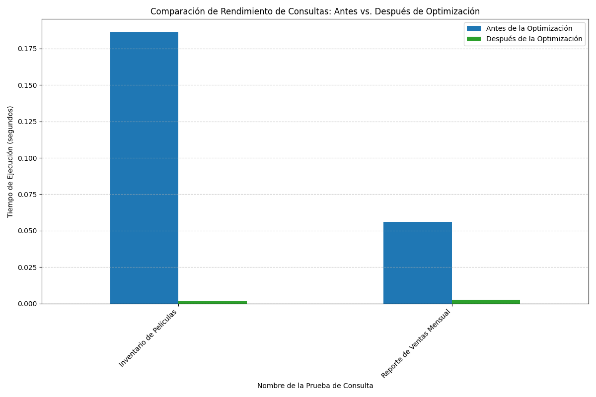

# 🚀 Database Performance Analysis - Before and After Improvements


---

## 📌 Purpose
This project runs a **comparative analysis** of a **PostgreSQL** database's performance before and after improvements. It is designed to:

- Measure the impact of optimizations on critical queries
- Identify performance bottlenecks
- Validate that the changes actually work
- Produce detailed reports for decision-making

## 📋 Technical summary
The project uses **Python, psycopg2, pandas and matplotlib** to:
1. Run SQL queries stored in files
2. Measure execution time and resource usage
3. Analyze the indexes used by each query
4. Generate comparative reports with charts
5. Track performance trends over time

👉 The result is a **detailed report** that quantifies the performance gain and informs future optimizations.

---

## ✨ Key features

### 🔍 Query analysis
- Runs SQL queries stored in files
- Precise execution-time measurement
- Row counts
- Index usage detection

### 📈 Comparative analysis
- Side-by-side before/after metrics
- Improvement percentages
- Comparative charts
- Trend tracking over time

### 📊 Reports
- Detailed Markdown report
- Comparative performance charts
- Index usage analysis
- Performance trends over time

### 🛠️ Ease of use
- Centralized configuration
- Clear project structure
- Modular, documented code
- Easy to plug into existing workflows

---

## 📂 Project structure

### Output folder (`/output`)
The `output/` folder holds every result produced by the performance tests:

- `before_results.csv`: results before the improvements
- `after_results.csv`: results after the optimizations
- `historical_results.csv`: full history of every run, for trend analysis
- `performance_comparison.png`: visual comparison chart

#### Example comparison chart

<div align="center">
  
  <p><em>Figure 1: performance before and after the improvements</em></p>
</div>

These files are updated on every run, so you can track performance over time.

```
/proyecto_db_performance
├── requirements.txt             # Python dependencies
├── scripts/
│   ├── config.py               # Database connection settings
│   ├── performance_test.py     # Main measurement script
│   └── report_generator.py     # Report generator
├── queries/                    # SQL queries
│   ├── antes/                  # Original queries (before improvements)
│   └── despues/                # Optimized queries (after improvements)
├── data/
│   └── query_map.json          # Query mapping for the comparison
└── output/                     # Results and reports
    ├── before_results.csv      # Baseline results
    ├── after_results.csv       # Post-optimization results
    ├── historical_results.csv  # Run history
    └── performance_comparison.png  # Comparison chart
```

### Key files

- **`scripts/performance_test.py`**:
  - Runs the SQL queries and measures their performance
  - Records time, rows processed and index usage
  - Stores the results in CSV files

- **`scripts/report_generator.py`**:
  - Generates comparative Markdown reports
  - Creates performance charts
  - Analyzes trends over time

- **`data/query_map.json`**:
  - Defines the queries to run and their metadata
  - Maps each "before" query (`antes`) to its "after" equivalent (`despues`)

## 🚀 Quick start

### 🔧 Prerequisites
- Python 3.8 or later
- PostgreSQL 10 or later
- Project dependencies: `pip install -r requirements.txt`

### 🔄 Workflow

#### 1️⃣ Baseline
```bash
# Run the tests on the current state (before improvements)
python -m scripts.performance_test antes
```

#### 2️⃣ Optimization
- Apply the database improvements
- Optimize queries, indexes and configuration
- Document the changes

#### 3️⃣ Validation
```bash
# Run the tests after the improvements
python -m scripts.performance_test despues
```

#### 4️⃣ Report
```bash
# Generate the comparative report
python -m scripts.report_generator
```

### 📊 Reading the results

The files in `output/` let you analyze:

1. **Detailed results** (`before_results.csv` and `after_results.csv`):
   - Execution time of each query
   - Rows processed
   - Indexes used
   - Performance trends

2. **History** (`historical_results.csv`):
   - How performance evolves over time
   - Patterns or regressions
   - Comparison across optimization cycles

3. **Chart** (`performance_comparison.png`):
   - Visual comparison between the baseline and the optimized state
   - Quick view of gains or problems
   - Regenerated on every run

The generated report includes:
- Execution-time comparison
- Index usage analysis
- Performance trends
- Optimization recommendations

### 🔄 Later runs
Every run is added to the history, which lets you:
- Track long-term trends
- Measure the impact of incremental optimizations
- Catch performance regressions
